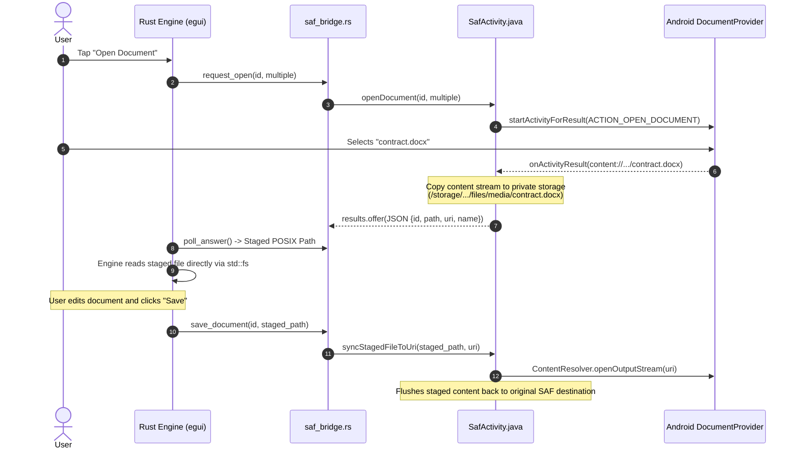
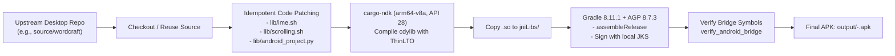

# ArtCraft Android Architecture Specification

This document provides a comprehensive architectural breakdown of the **ArtCraft Android Builder** and its mobile runtime layer. It details how desktop Rust/egui applications (WordCraft, PhotoCraft, VectorCraft, etc.) are transformed into production-ready, native Android applications.

---

## 1. High-Level System Architecture

The system operates across three distinct execution domains:
1. **Android Java/Kotlin Framework** (`GameActivity`, `AppCompat`, Android Windowing, SAF, IME).
2. **Native C/Glue Layer** (`libandroid-activity`, Android NDK, `ALooper`, EGL/Vulkan).
3. **Rust Application Engine & Shell** (`winit`, `egui-wgpu`, `saf_bridge`, `ime_bridge`, `mobile_overlay`, application engine).

```mermaid
flowchart TB
    subgraph AndroidJava["Android OS & Java Host (GameActivity)"]
        Activity["SafActivity (Java)\n- Immersive Fullscreen\n- WindowInsets & Theme Sync\n- File Picker / SAF\n- PrintManager\n- Background IO Pool"]
        HiddenIME["Hidden EditText (Host View)\n- InputConnection\n- Key & Composition Queue\n- imeLocked Guard"]
        SysServices["Android Services\n- ClipboardManager\n- DocumentProvider\n- System Fonts"]
    end

    subgraph NativeGlue["Native OS Bridge (NDK)"]
        Looper["ALooper & Event Queue\n- Native Input Queue\n- ALooper_wake on IME event"]
        NativeWindow["ANativeWindow\n- Surface Lifecycle\n- Display Metrics"]
    end

    subgraph RustRuntime["Rust Mobile Shell (wordcraft_android cdylib)"]
        AndroidApp["android-activity (Rust)\n- Event Loop & App Lifecycle\n- Main Thread Runner"]
        Winit["Customized winit\n- Gesture State Machine (Pan/Pinch)\n- Synthetic CursorMoved Events\n- Physical Key Tracking"]
        Bridges["JNI Subsystem\n- saf_bridge (File IO / SAF)\n- ime_bridge (Keyboard Polling)\n- system_fonts (Fontconfig/Symlinks)"]
        Overlay["Mobile Touch Overlay\n- Virtual Modifiers (Ctrl/Alt/Shift)\n- Keyboard Lock Toggle\n- Long-Press Right Click (~450ms)\n- Quick Zoom (+/-)"]
        Egui["egui UI Framework\n- Immediate-Mode Widgets\n- Modifier Synthesis\n- Canvas Rendering"]
        Engine["App Engine (WordCraft / PhotoCraft)\n- Document Model\n- Rendering & File Processing"]
    end

    Activity <-->|JNI Direct Invocation| Bridges
    HiddenIME -->|Drained via imePoll()| Bridges
    Looper --> Winit
    NativeWindow --> Winit
    Bridges --> Overlay
    Winit --> Overlay
    Overlay --> Egui
    Egui --> Engine
    Activity -->|ALooper_wake| Looper
    SysServices <-->|JNI| Bridges
```

---

## 2. The Bridge Layer (Java Host & JNI)

Native Android applications created with Rust cannot directly call Android Java SDK APIs (like `InputMethodManager`, `ClipboardManager`, or `DocumentsContract`) through standard POSIX C interfaces. This project implements a high-throughput, thread-safe JNI bridge.

### 2.1 The Java Host: `SafActivity`
Located at [`templates/android/SafActivity.java`](file:///home/sumedh/artcraft-android/templates/android/SafActivity.java):
* **Class Hierarchy**: Inherits from `com.google.androidgamesdk.GameActivity`, ensuring compatibility with the Google Android Game SDK and modern native window lifecycles.
* **Responsibilities**:
  1. **SAF Document Dispatching**: Coordinates `ACTION_OPEN_DOCUMENT`, `ACTION_CREATE_DOCUMENT`, and `ACTION_OPEN_DOCUMENT_TREE` intents.
  2. **Soft Keyboard Hosting**: GameActivity has no text input focus by default. `SafActivity` embeds an invisible 1x1 pixel `EditText` with a customized `InputConnectionWrapper` to intercept text commits, deletions, and composition strings.
  3. **Immersive Fullscreen & Insets Controller**: Drives `WindowInsetsController` to maintain transparent system navigation and status bars while dynamically matching icon contrast (dark/light icons) to egui's rendered theme.
  4. **Native Printing**: Employs `android.print.PrintManager` to pipe Rust-generated PDF byte buffers directly into Android's system print spooler.

### 2.2 The Rust JNI Bridge
Located at [`templates/android/saf_bridge.rs`](file:///home/sumedh/artcraft-android/templates/android/saf_bridge.rs) and [`templates/android/ime_bridge.rs`](file:///home/sumedh/artcraft-android/templates/android/ime_bridge.rs):
* **Thread Attachment**: Background worker threads attach to the JVM on-demand using `JavaVM::attach_current_thread`.
* **Execution Boundary**: Operations affecting UI views (like `imm.showSoftInput` or `window.setSystemUiVisibility`) are dispatched through `AndroidApp::run_on_java_main_thread` or `Activity.runOnUiThread`.
* **Exception Boundary**: Every JNI method execution clears Java exceptions immediately (`env.exception_clear()`) and maps failures into Rust `Result<T, String>` to prevent JVM crashes from aborting the native process.

---

## 3. Storage & The SAF Virtual File System

Desktop editing software assumes direct POSIX filesystem paths (`/home/user/document.docx`). Modern Android (API 29+ Scoped Storage) strictly forbids raw filesystem access to arbitrary user files and enforces the Storage Access Framework (`content://` URIs).

### 3.1 The Staging Pipeline



### 3.2 Key Mechanisms
* **Deduplication Strategy**: When opening multiple documents with identical filenames, suffixing (`document (2).docx`) prevents overwriting.
* **Persistent Permissions**: Calls `contentResolver.takePersistableUriPermission(uri, ...)` so files remain accessible across reboots.
* **Garbage Collection Sweep**: A background cleaner runs 30 seconds after launch to evict orphaned staged files in `files/media/` that are no longer referenced in the recent files index or open sessions.

---

## 4. Input, Touch Gestures & IME Subsystem

Desktop egui is designed for physical mice and keyboards. The mobile port bridges this gap through three cooperative layers.

### 4.1 Touch Gesture Disambiguation (Custom `winit`)
In [`vendor/winit/src/platform_impl/android/mod.rs`](file:///home/sumedh/artcraft-android/vendor/winit/src/platform_impl/android/mod.rs):
* **Deadzone Arbitration**:
  * `PAN_DEADZONE_PX = 14.0`: Distance midpoint must travel to trigger a two-finger scroll.
  * `PINCH_DEADZONE_PX = 14.0`: Distance spread must change to trigger a pinch zoom.
  * `PINCH_SPREAD_RATIO = 0.75`: Ratio allowing single-finger anchored pinches to be recognized immediately.
* **Dynamic State Transition**: Supports bidirectional live handover between `Gesture::Pan` and `Gesture::Pinch` without lifting fingers.
* **Midpoint Cursor Synthesis**: Injects synthetic `WindowEvent::CursorMoved` events representing the midpoint between the two touches, allowing egui to compute exact zoom anchors (`zoom_anchor = page_at(midpoint)`).

### 4.2 Soft Keyboard (IME) Host & Deduplication
In [`templates/android/SafActivity.java`](file:///home/sumedh/artcraft-android/templates/android/SafActivity.java) and [`lib/ime.sh`](file:///home/sumedh/artcraft-android/lib/ime.sh):
* **Event Polling**: `imeEvents` queue is polled by the native shell once per frame.
* **Double-Backspace Deduplication**: Android IMEs frequently send both `deleteSurroundingText(1,0)` and `sendKeyEvent(KEYCODE_DEL)`. The bridge tracks timestamps and drops duplicates occurring within `IME_DELETE_PAIR_MS = 30L`.
* **ALooper Wakeup**: Native loops sleep in `ALooper_pollOnce`. To prevent text commits waiting up to 500ms for cursor blink repaints, every IME event sends a synthetic `ALooper_wake` with `KEYCODE_UNKNOWN`.
* **Keyboard Lock (`imeLocked`)**: Accidental screen taps do not trigger keyboard popup when the lock button is enabled. The overlay clears `ctx.output_mut(|o| o.ime = None)`.

### 4.3 Mobile Touch Accessory Overlay
In [`templates/android/mobile_overlay.rs`](file:///home/sumedh/artcraft-android/templates/android/mobile_overlay.rs):
* **Floating Dock**: Draggable overlay positioned in the foreground (`egui::Order::Foreground`).
* **Virtual Modifiers**: Sticky state toggles for `Ctrl`, `Alt`, `Shift`, and `Space` (pan).
* **Touch Long-Press Right Click**: Detects stationary finger contact (~450ms) and synthesizes a secondary mouse click for context menus.
* **Keyboard Lock & Force Buttons**: Toggle between auto-suppression and explicit keyboard summon.

---

## 5. Windowing, Graphics & Mobile Lifecycle

Rust native graphics on Android use `egui-wgpu` and `winit` on top of `android-activity`.

```mermaid
stateDiagram-v2
    [*] --> Init: App Launch
    Init --> Resumed: NativeActivity onResume
    Resumed --> SurfaceCreated: NativeWindow Created
    SurfaceCreated --> Rendering: Configure wgpu Surface

    state Rendering {
        [*] --> PollInput: ALooper_pollOnce
        PollInput --> UpdateOverlay: MobileOverlay::ui
        UpdateOverlay --> RenderWidgets: egui::Context::run
        RenderWidgets --> PresentSurface: wgpu Queue::submit & present
        PresentSurface --> PollInput
    }

    Rendering --> SurfaceDestroyed: onWindowDestroyed (Suspend/Background)
    SurfaceDestroyed --> Paused: onPause
    Paused --> SurfaceCreated: Foregrounded again
    Paused --> Destroyed: Process Termination
    Destroyed --> [*]
```

### 5.1 ANR and Surface Invalidation Handling
* When an app is sent to the background, Android destroys the `ANativeWindow`.
* Continuing to render or submit to a stale surface causes hard EGL/Vulkan crashes or ANRs (Application Not Responding).
* The vendored `android-activity` and `egui-wgpu` listen for `Event::Suspended` and drop the `wgpu::Surface`, re-instantiating the swapchain only after receiving `Event::Resumed` and a valid new native window handle.

---

## 6. Font Virtualization Subsystem

In [`templates/android/system_fonts.rs`](file:///home/sumedh/artcraft-android/templates/android/system_fonts.rs):
* **The Symlink Problem**: Android emulated storage (`/storage/emulated/0`) rejects UNIX `symlink()` calls with `EPERM`.
* **The Solution**:
  1. The builder creates symlinks pointing to `/system/fonts` and `/product/fonts` inside the app's **internal private storage** (`/data/user/0/<pkg>/files/fonts`).
  2. Injects custom `fonts.conf` into fontconfig paths (`$HOME/.fonts`, `$XDG_DATA_HOME/fonts`).
  3. Every egui font family dynamically registers system fallbacks to guarantee glyph coverage for CJK, Arabic, Thai, Khmer, and Indic scripts.
  4. Scans `/sdcard/Fonts` if "All Files Access" is granted to load user-installed TTF/OTF files.

---

## 7. Build Pipeline & Code-Patching Engine

The build system in [`lib/build-common.sh`](file:///home/sumedh/artcraft-android/lib/build-common.sh) automates the entire porting pipeline without requiring modifications to upstream desktop repositories.



* **Idempotent Python Patchers**: Apply exact, contextual string substitutions to app source files (e.g. hooking IME handlers and touch gestures) that run safely on fresh clones or existing builds without duplicate patching.
* **Manifest & Icon Generation**: Dynamically constructs `AndroidManifest.xml` with intent filters derived from [`lib/file_associations.py`](file:///home/sumedh/artcraft-android/lib/file_associations.py) and adaptive vector icons generated by [`lib/app_icons.py`](file:///home/sumedh/artcraft-android/lib/app_icons.py).
