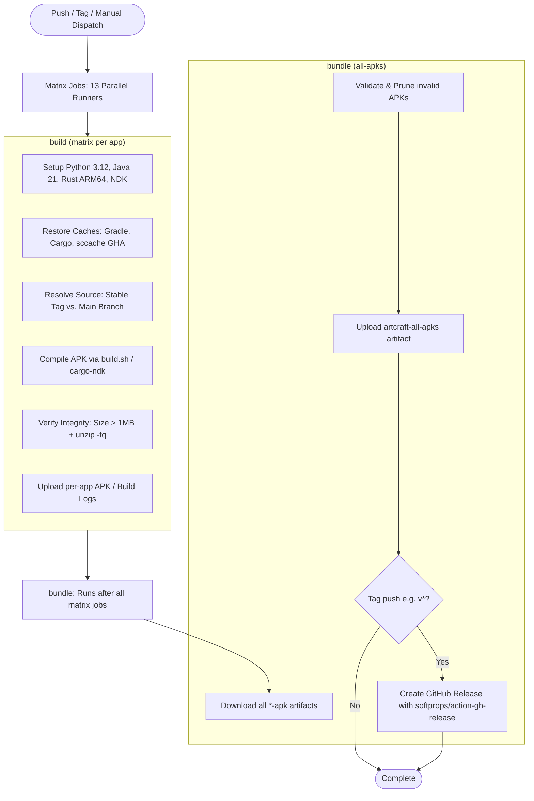

# GitHub Actions CI/CD Workflow (`.github/workflows/build.yml`)

This document details the architecture, design principles, caching strategy, security permissions, and execution lifecycle of the ArtCraft Android continuous integration and release pipeline.

---

## 1. Overview & Architecture

The workflow automates building, testing, verifying, and publishing Android APKs for all 13 Storytold applications across an independent build matrix.



---

## 2. Triggers & Concurrency

### Triggers
1. **Push to Branches (`branches: ['**']`):**
   Runs automatically on all branch commits to ensure PRs and branch updates don't break Android compatibility.
2. **Push to Tags (`tags: ['**']`):**
   When pushing semantic release tags (e.g. `v1`, `v0.2.0`), triggers the full matrix build and publishes an official GitHub Release.
3. **Manual Dispatch (`workflow_dispatch`):**
   Allows manual runs from the GitHub Actions UI with custom parameters:
   - `mode`: `release` (default, optimized) or `debug` (faster build, larger binary).
   - `source_version`: `stable` (default, latest release tags) or `main` (bleeding-edge rolling upstream commits).

### Concurrency Control
```yaml
concurrency:
  group: ${{ github.workflow }}-${{ github.ref }}
  cancel-in-progress: true
```
If new commits are pushed to the same branch while a build is running, older pending runs are immediately cancelled. This prevents runner queue starvation and saves GitHub Actions minutes.

---

## 3. Permissions

The workflow specifies two explicit permissions:
```yaml
permissions:
  contents: write
  actions: write
```

| Permission | Purpose |
| :--- | :--- |
| `contents: write` | Required to create GitHub Releases, tag releases, and attach compiled `.apk` files via `softprops/action-gh-release@v2`. |
| `actions: write` | **Critical for `sccache`:** GitHub Actions Cache requires the Actions read/write API token. Without `actions: write`, `sccache` hits `403 Forbidden` on cache storage, causing all cache operations to miss. |

---

## 4. Multi-Layer Caching Strategy

Rust Android cross-compilation builds hundreds of native crates and dependencies per app. The pipeline uses a three-tier caching hierarchy to reduce build times from ~30 minutes down to ~5–8 minutes on warm runners:

### Tier 1: `sccache` (Shared Compiler Cache)
* **Action:** `mozilla-actions/sccache-action@v0.0.8`
* **Backend:** Native GitHub Actions Cache API (`SCCACHE_GHA_ENABLED: "true"`).
* **Compiler Wrapper:** `RUSTC_WRAPPER: "sccache"`
* **What it caches:** Compiled C/C++ and Rust crate artifacts (`.o`, `.rlib`, `.rmeta`). If multiple apps share identical dependencies (e.g., `egui`, `vello`, `winit`, `cpal`, `symphonia`), `sccache` shares compilation hits across matrix jobs.

### Tier 2: Cargo Registry & Git DB
* **Action:** `actions/cache@v4`
* **Paths:** `~/.cargo/registry/index/`, `~/.cargo/registry/cache/`, `~/.cargo/git/db/`
* **Key:** `cargo-registry-${{ runner.os }}-${{ matrix.app }}-${{ hashFiles('lib/build-common.sh') }}`
* **Purpose:** Avoids re-downloading source crates and git repos from crates.io on every job.

### Tier 3: Gradle Wrapper & Cache
* **Action:** `actions/cache@v4`
* **Paths:** `~/.gradle/caches`, `~/.gradle/wrapper`
* **Key:** `gradle-${{ runner.os }}-${{ matrix.app }}-${{ hashFiles('lib/build-common.sh') }}`
* **Purpose:** Caches the Gradle binary and downloaded Android Gradle Plugin (AGP) dependencies.

---

## 5. Toolchain & Environment Optimization

### Rust & Cross-Compilation
* Rust stable with the `aarch64-linux-android` target installed via `dtolnay/rust-toolchain@stable`.
* Compiler tuning via environment variables:
  - `CARGO_PROFILE_RELEASE_CODEGEN_UNITS: "16"`: Parallelizes LLVM code generation across all available CPU cores.
  - `CARGO_PROFILE_RELEASE_LTO: "thin"`: Replaces monolithic Link-Time Optimization with ThinLTO, speeding up the final native `.so` link by up to 4× while retaining 95% of LTO performance gains.
  - `CARGO_PROFILE_RELEASE_DEBUG: "false"`: Strips debug symbols to conserve disk space and build cache size.

### Android SDK & NDK
* Dynamic runner discovery: Checks for pre-installed NDKs on GitHub Ubuntu runners (typically `27.2.12479018`) and sets `ANDROID_NDK_HOME` and `NDK_HOME`.
* Pinned `ARTCRAFT_BUILD_TOOLS_VERSION: "35.0.0"`.

### Rapid `cargo-ndk` Installation
Rather than building `cargo-ndk` from source via `cargo install` (which takes 3–5 minutes), the workflow extracts the pre-built musl binary release (`v4.1.2`) directly into `~/.cargo/bin` in < 2 seconds.

### Icon Preprocessing
* Uses Python 3.12 and Pillow.
* `lib/app_icons.py` generates adaptive Android launcher icons directly from pristine 1024×1024 PNG master sources using Pillow Lanczos filtering, avoiding ImageMagick SVG rendering bottlenecks.

---

## 6. Execution Lifecycle: The `build` Matrix Job

Each app runs as an independent runner in the matrix:
```yaml
strategy:
  fail-fast: false
  matrix:
    app:
      - photocraft
      - vectorcraft
      - filmcraft
      - lightcraft
      - pdfcraft
      - effectcraft
      - designcraft
      - figcraft
      - wordcraft
      - soundcraft
      - deckcraft
      - cadcraft
      - gridcraft
```

### Why `fail-fast: false` is Critical
If upstream changes in one app (e.g. `soundcraft`) cause a compilation failure, `fail-fast: false` ensures the remaining 12 apps continue building without being prematurely cancelled.

### Source Resolution (Stable Releases vs. Main)
The step passes `BUILD_SOURCE: ${{ inputs.source_version || 'stable' }}` to `build.sh`:
* When `BUILD_SOURCE == "stable"`: Queries the latest release tag (`git ls-remote --tags --sort=-v:refname <repo> 'v*'`) and checks out that release tag (e.g. `soundcraft` -> `v0.12.1`). This isolates CI builds from broken commits or unfinished merges on upstream `main`.
* When `BUILD_SOURCE == "main"`: Clones the head of the default upstream branch.

### Atomic Output & Integrity Verification
1. **Pre-build cleanup:** `rm -f output/*.apk output/*.tmp` ensures stale builds are never uploaded.
2. **Integrity checks:**
   ```bash
   # Check size
   if [ "$size" -lt 1000000 ]; then ... exit 1; fi
   # Check zip structure
   if ! unzip -tq "$apk"; then ... exit 1; fi
   ```
   Ensures that empty (0-byte) or truncated APKs fail the job immediately rather than being uploaded as corrupt artifacts.

### Diagnostic Uploads
* **Success:** Uploads `<app>-apk` containing the verified APK.
* **Failure (`if: failure()`):** Uploads `<app>-build-log` containing `logs/` to allow developers to inspect the compiler output and traceback without runner access.

---

## 7. Execution Lifecycle: The `bundle` Job

The `bundle` job runs after all matrix jobs finish:
```yaml
bundle:
  name: Bundle All APKs
  needs: build
  runs-on: ubuntu-latest
  if: always()
```

1. **`if: always()`:** Always executes, even if some apps failed.
2. **Download Artifacts:** Pulls all `*-apk` artifacts into `all-apks/`.
3. **Second-Pass Validation:** Inspects all downloaded APKs, removes any corrupted or incomplete files, and sets `has_apks=true` if valid APKs exist.
4. **Combined Artifact:** Uploads `artcraft-all-apks` containing all successfully built APKs in one zip.
5. **Release Creation:**
   If the pipeline was triggered by a tag starting with `v` (e.g. `git push origin v1`), `softprops/action-gh-release@v2` publishes a GitHub Release containing all individual APKs and generated release notes.

---

## 8. Summary of Workflow Best Practices

1. **Never ship broken APKs:** Multi-stage validation (`size > 1MB` and `unzip -tq`) ensures corrupt or empty artifacts are discarded.
2. **Reproducible builds:** Stable tag targeting guarantees deterministic builds identical to upstream releases.
3. **Resilient matrix:** Individual failures do not disrupt the rest of the suite.
4. **Traceable debugging:** Full logs are captured and preserved as artifacts on failure.
